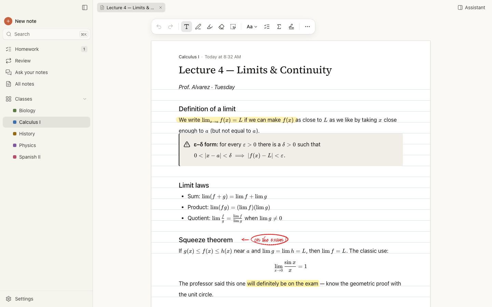
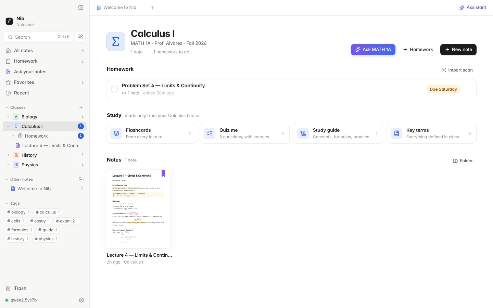
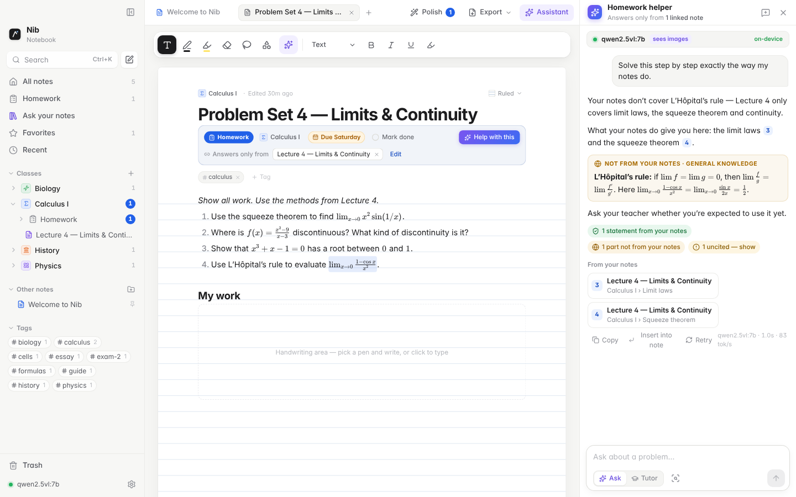
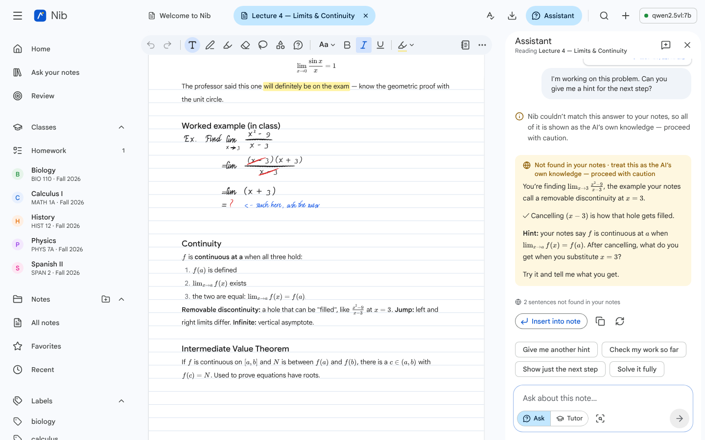
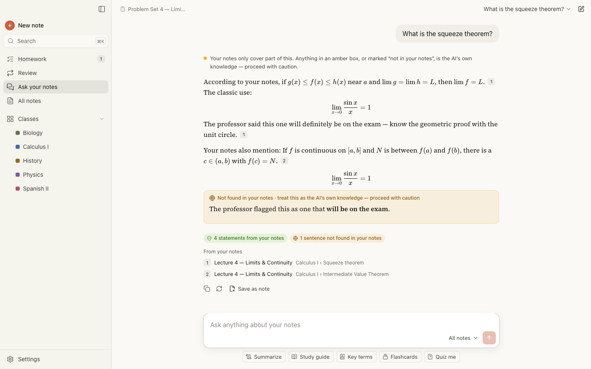

# Nib

**A notebook for students where typing and handwriting share one page, and your own local AI can read all of it.**

Nib is a Mac app. Write equations by hand and type sentences around them, sort everything into classes, and ask a model running on your own computer about anything on the page. No screenshots, no copying into a chatbot, and nothing leaves your Mac.



## What it does

### Type and write on the same page
- **Any pen, anywhere.** Fountain pen, ballpoint, brush pen, pencil, felt marker and highlighter, each with its own colours and sizes. Ink snaps to the same baseline grid as typed text, so the two line up.
- **Switching is seamless.** Write a few lines, then just start typing: the text lands on the next ruled line under your handwriting. Press <kbd>Esc</kbd> to pick the pen back up.
- **Symbols inline.** Draw a symbol at the end of a typed line and it joins the sentence as an inline glyph. You can also press <kbd>⌘D</kbd> to sketch one at the cursor.
- **Shapes and editing.** Hold at the end of a stroke to snap a circle, box, line or arrow. Lasso a selection to move, scale, recolour, copy or ask about it. The precise eraser cuts through strokes instead of deleting them.
- **Formatting that looks good without effort.** Markdown shortcuts, a `/` menu for every block, LaTeX math (`$x^2$`, `$$…$$`), callouts and checklists.
- **Polish.** One button suggests cleanups: a title and tags, tidier spacing, matching ink colours, typeset handwritten math, and a summary at the top.

### Classes
Create a class (name, course code, teacher, term, colour, icon) and everything follows it:
- new notes, homework, *Ask your notes* and the study tools all scope to the class you're in;
- the class page brings together homework due, flashcards and quizzes made from that class's notes, and the notes themselves;
- on disk a class is an ordinary folder of `.nib` files, so the vault is still Obsidian-style plain files.



### Homework that sticks to your notes
- **Start blank or from a scan.** Begin with an empty page, or drop in a PDF or photo of the worksheet and write directly on it. If the scan has no text layer, Nib reads the pages with your vision model so the assistant can see the questions.
- **Link the notes it covers.** Nib suggests the lectures that match the questions, and you can link whole classes or individual notes.
- **Answers follow your notes exactly.** The homework helper uses only the linked notes and the same method, steps and notation as your teacher, and it cites every claim. Where the notes don't cover something, it says so and puts any general-knowledge help in a box marked **Not from your notes**.
- **Grounding check.** Under each answer, Nib counts the statements backed by your notes, flags anything uncited and any citation that doesn't match its excerpt, and shows the cited passage when you click a citation.
- Due dates, a done checkbox, and a Homework list grouped by what's due.



### An assistant that sees the whole page
- **Ask about anything.** Select text, lasso handwriting, or drag the **✦ Ask** tool over any area, and the model gets the whole note plus exactly what you pointed at.
- **Tutor mode for math.** It works out what you're trying to do from your own steps and gives one hint at a time. Ask for *Check my work* to mark each step ✓/✗, or *Solve* for the full solution.
- **Insert into note.** Put an answer straight into the note, right after the problem it's about.



### Ask your notes
Your own NotebookLM, running locally. Answers come only from your notes, with numbered citations that open the exact passage, so you know it's what was taught in class. Search the whole vault, a single class, a folder or a tag. Study tools build a study guide, flashcards, a quiz or a glossary from your notes.



### Everything else you'd expect
Obsidian-style folder tree with drag and drop, tabs, favorites, tags and trash. Quick open and commands with <kbd>⌘K</kbd>. Import Markdown, PDF and images. Export to PDF (ruled paper included), Markdown, HTML or `.nib`. Five paper styles, Letter and A4, zoom.

## Set up a local model

Nib talks to any local server that speaks the **Ollama** API or the **OpenAI-compatible** API (LM Studio, llama.cpp, vLLM, Jan…).

```bash
# https://ollama.com
ollama pull qwen2.5vl:7b       # reads handwriting, math and scans
ollama pull nomic-embed-text   # optional: semantic search in Ask your notes
```

Then open **Settings → Local AI** (<kbd>⌘,</kbd>) and press **Detect**. Nib scans the usual ports, picks a chat model, a vision model and an embedding model, and shows each model's real context window.

How Nib handles a local model:
- **One model at a time.** A question you ask jumps the queue and pauses background work, such as reading handwriting, which picks up again afterwards.
- **Recovers on its own.** Busy or restarting servers are retried before any text appears. A cold model shows "loading" instead of hanging. If the server goes away, Nib reconnects when it's back.
- **Cut-off answers can be continued.** If a reply hits the token limit, **Continue** finishes the same answer.
- **Fits the model.** Prompts are trimmed to the model's own context window, and JSON study tools get one automatic repair attempt.
- **Activity log.** **Settings → Local AI → Activity** lists every request with its timing, tokens per second and retries, plus a **Test model** button.

## Run it

```bash
npm install
npm run app:dev        # the Mac app with hot reload
npm run dev            # or the browser build at http://localhost:5173 (notes stay in the browser)
npm run dist:mac       # build release/Nib-<version>.dmg
```

The app keeps its vault in `~/Documents/Nib Vault` (*Settings → Vault* to change it). Every note is a `.nib` JSON file in a folder per class. Class details live in `.nib/folders.json`, and the search index in `.nib/embeddings.json`.

## Keyboard

| | |
|---|---|
| <kbd>⌘N</kbd> / <kbd>⇧⌘Y</kbd> | New note / new homework (in the current class) |
| <kbd>⌘K</kbd> | Quick open, search inside notes, commands |
| <kbd>⌘J</kbd> | Assistant |
| <kbd>⇧⌘L</kbd> | Ask your notes |
| <kbd>⌥P</kbd> <kbd>⌥H</kbd> <kbd>⌥E</kbd> <kbd>⌥L</kbd> <kbd>⌥T</kbd> | Pen, highlighter, eraser, lasso, text |
| <kbd>Esc</kbd> | Back to the last pen after typing |
| <kbd>⌘D</kbd> | Sketch a symbol inline |
| <kbd>/</kbd> | Insert any block |
| <kbd>⌘P</kbd> | Export as PDF |

The full list is in **Settings → Shortcuts** (<kbd>⌘/</kbd>).

## How it's built

- **Electron** shell (`electron/`) with a native menu and a hidden-inset title bar. A sandboxed preload exposes a small bridge: vault files with path-escape checks, a streaming HTTP proxy to the model server (no CORS), screen capture and PDF printing.
- **React + TipTap/ProseMirror** editor (`src/editor/`). Ink is stored on the blocks it belongs to (x relative to the text column, y to the block), drawn on one page-wide SVG layer, and every block snaps to the ruled-line grid.
- **AI** (`src/lib/ai/`):
  - `providers.ts` speaks Ollama and the OpenAI-compatible API.
  - `engine.ts` is the scheduler, retries, metrics and activity log.
  - `rag.ts` handles retrieval: section chunks, BM25 plus local embeddings fused with reciprocal-rank fusion.
  - `prompts.ts` holds the prompts tuned for 3–14B models, and `grounding.ts` runs the citation check.
- **Classes and homework** live in `src/lib/classes.ts` and `src/lib/homework.ts`; reading scanned pages is in `src/lib/scan.ts`.

## Tests

```bash
npm run typecheck
npm test               # unit tests, incl. the model engine against a mock server with injected faults
npm run test:e2e       # browser end-to-end: ink, AI, homework & classes
npm run test:all       # all of the above + build + the desktop app (xvfb on Linux)
```

`scripts/mock-llm.mjs` is a stand-in model server for both APIs, with streaming, thinking models, vision flags and embeddings. Tests can make it fail, cut replies short or load slowly through `POST /__mock` (`{"fail": 2, "status": 503}`, `{"truncate": 1}`, `{"firstTokenMs": 3000}`), so the retry, continue and loading paths are tested end to end.

CI (`.github/workflows/ci.yml`) runs everything on every push. `mac.yml` builds the `.dmg`.

## Privacy

Nib makes no network requests except to the model server you configure, which is usually on `localhost`. Your notes are plain files in a folder you choose.
