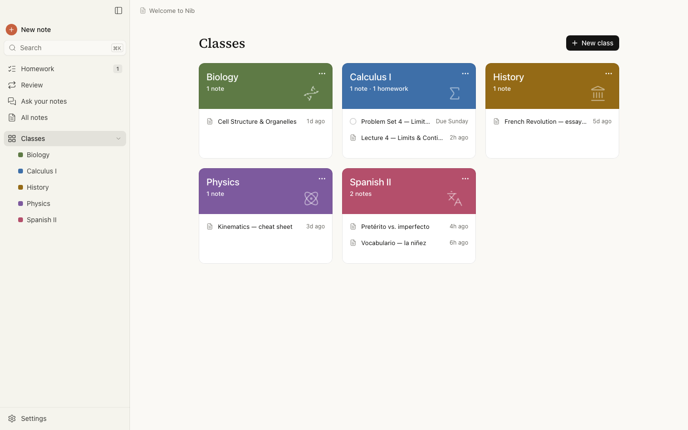

# Nib

**A notebook for students where typing and handwriting share one page, and your own local AI can read all of it.**

Nib is a Mac app. Write equations by hand and type sentences around them, keep each subject in a class, and ask a model running on your own computer about anything on the page. No screenshots, no copying into a chatbot, and nothing leaves your Mac.


## What it does

### Answers come from your notes, and say so when they don't
Every AI feature in Nib answers **only from your notes**, with a numbered citation on each statement that opens the exact passage. When your notes don't have the answer, Nib says so first (*"Your notes don't cover this"*) and only then gives the AI's own answer, in a box marked **Not from your notes · the AI's own knowledge — proceed with caution**. You can turn those answers off entirely in *Settings → Local AI*.

This doesn't rely on the model behaving. Nib's harness enforces it in code:
- **Before asking**, it checks whether your notes cover the question at all. If they don't, no notes prompt is sent, so nothing can be dressed up as coming from them.
- **After answering**, every sentence is checked against the passage it cites: invented names, numbers, rules or quotes, contradictions ("…does **not** exist" when your notes say it does), and claims no passage backs are moved into the labelled box. Missing citations are added or corrected.
- **Loosely matched** sentences get a second look: the model must quote the passage that says it, and Nib verifies the quote itself.
- Parts the notes don't cover are answered in a separate call whose whole reply is boxed, so general knowledge never mixes into the cited text.
- A reply that stops early (you press Stop, ask something else, or the connection drops) is checked the same way. Unchecked text is never shown, copied or inserted outside a box.

How well does that hold? The check is code, so it has blind spots: it reads words, not meaning. `npm run eval:grounding` throws 39 invented claims written to slip past it at the demo notes. On this version, 2 of the 39 still reach the student without a label after the double-check (a claim built from words of different lines, and a contradiction the notes never spell out), and 1 of 24 true sentences, tutoring talk included, gets boxed. So "everything outside a box is from your notes" means everything outside a box passed this check, not that it is certain.

### Type and write on the same page
- **One felt marker.** Every stroke is the felt marker, in three sizes and three quick colors (more in a color picker), with a highlighter beside it. Ink snaps to the same baseline grid as typed text, so the two line up.
- **Switching is seamless.** Write a few lines, then just start typing: the text lands on the next ruled line under your handwriting. Press <kbd>Esc</kbd> to pick the marker back up.
- **Symbols inline.** Draw a symbol at the end of a typed line and it joins the sentence as an inline glyph. You can also press <kbd>⌘D</kbd> to sketch one at the cursor.
- **Select works like a screenshot box.** Pick **Select** (<kbd>⌥S</kbd>) and drag a box over anything, as with <kbd>⇧⌘4</kbd> on a Mac. Hold <kbd>Space</kbd> to move the box, <kbd>⌥</kbd> to grow it from the center, <kbd>Esc</kbd> to cancel. Handwriting in the box is selected, ready to move, scale, recolor, copy, or turn into text or math. A box over typed text, an equation or a scan asks about that area instead.
- **Move it like paper.** With Select (or <kbd>⌘</kbd> and the marker), press on a handwritten word or drawing and drag: it comes as a whole and lands on the nearest ruled line, lined up with the margin or the handwriting above it, with guides as you go. Drop it onto a line of text and it joins the sentence (shrunk to fit if it must be). Drag a sketch out of the text to make it handwriting again, at its old size. Hold <kbd>⌥</kbd> to place it freely.
- **Shapes.** Hold at the end of a stroke to snap it into a circle, box, line or arrow. The eraser takes whole strokes or cuts through them.
- **Paper.** Blank, Squared or Lined, picked when you make a note or a homework: one click on a paper in **New note** makes the note. <kbd>⌘N</kbd> uses the paper you picked last, and the empty note still offers the choice until you write in it.
- **Nothing needs a title.** An untitled note goes by its first line, else what its handwriting says, else its date.
- **Formatting without effort.** Markdown shortcuts, a `/` menu for every block, LaTeX math (`$x^2$`, `$$…$$`), callouts and checklists.
- **Polish.** In a note's ⋯ menu: tidier spacing, matching ink colors, typeset handwritten math, and a summary at the top.

### Classes
The start page shows every class as a card, and **New class** sits at the top right. A class is a name, a color and an icon, nothing more, and everything follows it:
- a class page with a box to ask that class's notes, **New note**, **New homework** and **Review**, then its homework (tick to finish) and its notes, folders first, then by when they were last edited;
- new notes, homework, *Ask your notes* and Review all start from the class you're in;
- on disk a class is an ordinary folder of `.nib` files, so the vault is still plain files.




### Homework that sticks to your notes
- **Start blank or from a scan.** Pick the paper, or drop in a PDF or photo of the worksheet and write directly on it. If the scan has no text layer, Nib reads the pages with your vision model so the homework helper can see the questions.
- **Link the notes it covers.** By default a homework uses its class's notes. Nib suggests the lectures that match the questions, and you can link whole classes or single notes.
- **Answers follow your notes exactly.** The homework helper uses only the linked notes and the same method, steps and notation as your teacher, and it cites every claim. Where the notes don't cover something, it says so and puts any general-knowledge help in a box marked **Not from your notes**.
- **Grounding check.** Under each answer, Nib counts the sentences backed by your notes, flags anything it couldn't find in them, and shows the cited passage when you click a citation.
- **One list.** Due dates, *Mark done*, and a Homework page grouped Overdue, Today, Tomorrow, This week and Later, with what's done folded away.


### An assistant that sees the whole page
- **Ask about anything.** Select text, or drag a Select box over handwriting, typed text or a scan, and the model gets the whole note plus exactly what you pointed at.
- **Tutor mode for math.** It works out what you're trying to do from your own steps and gives one hint at a time. Ask it to *Check my work* to mark each step ✓/✗, or *Solve it* for the full solution.
- **Insert into note.** Put an answer straight into the note, right after the problem it's about. Anything not from your notes stays marked when it's inserted.


### Ask your notes
A chat page for your notes. Ask across all of them, one class, or the notes you choose (the scope under the box), and every answer cites the exact passage, so you know it's what was taught in class. **Summarize**, **Study guide**, **Key terms**, **Flashcards** and **Quiz me** build study material from the same notes and open it beside the conversation. Earlier conversations are kept in History.


### Review until you know it, from any mix of notes
Pick whole classes, chapters (a class's subfolders) or single notes, Spanish and Calculus together if you like, and Review quizzes you one question at a time, taking turns between the classes. It runs on Nib's **Mastery Engine**:
- **Questions come from your notes' own words.** Fill-in-the-blank, vocabulary, multiple choice (wrong choices are other lines from your notes), then *explain*, *apply* (to the example in your notes) and *connect* as you improve. Every answer key, key point and choice is a span of your notes, checked in code before a question is shown. The model may only re-phrase a question, and that's used only if the passage answers it, it doesn't give the answer away and it adds nothing your notes don't say.
- **Answers are checked against your notes.** Short answers are graded by code (an accent or a missing article gets a note, not a zero). Free answers are graded against your notes' key points, and the grader must quote your words for each one. "I don't know" is never sent to the model.
- **It learns what you know.** Each idea has a mastery estimate (Bayesian knowledge tracing), updated by how you answered and how sure you said you were. A wrong answer gets a hint back to the right line of your notes, one retry, then the line itself. Missed ideas come back a few questions later; mastered ones come back days later (spaced repetition), sooner if you were guessing.
- **Works offline.** Questions are built from the notes and short answers are checked by code, so Review runs while the local AI is off. Handwriting nothing has read yet can be read from the Review page with one click.
- **The summary** shows what you mastered, the mix-ups to fix (confident wrong answers first), how sure vs. how right you were, and when to come back. Your progress is saved with the vault in `.nib/review.json`.

Open it from the sidebar (<kbd>⇧⌘E</kbd>), a class page, a folder's or note's right-click menu, or <kbd>⌘K</kbd>.

### Everything else you'd expect
**All notes** lists every note the way Apple Notes does: folders first, then notes grouped by when they were last edited, with Trash a click away. Notes open in tabs. <kbd>⌘K</kbd> finds any note, class or command and searches inside your notes. Import Markdown, PDF and images. Export to PDF (with the paper), Markdown, HTML or `.nib`. Letter and A4, zoom.

### One design, borrowed from apps you already know
Nib doesn't invent its own interface. Each part borrows from the app that already does that job well, in one calm look: warm paper colors, black buttons, flat surfaces, and a serif for page titles and AI replies. The AI features use the same buttons and colors as everything else, so nothing looks like a separate add-on.

| In Nib | Modeled on |
|---|---|
| Classes page and adding a class | Google Classroom |
| App shell, dialogs, menus, Settings, Ask your notes, the assistant | Claude |
| Class page lists, All notes | Apple Notes |
| Homework list | Things and Apple Reminders |
| Ink tools (one felt marker) | GoodNotes and Notability |
| Select | macOS <kbd>⇧⌘4</kbd> |
| Review | Anki |

## Set up a local model

Nib talks to any local server that speaks the **Ollama** API or the **OpenAI-compatible** API (LM Studio, llama.cpp, vLLM, Jan…). Install one (for example from [ollama.com](https://ollama.com)), then open **Settings → Local AI** (<kbd>⌘,</kbd>) and press **Detect**. Nib scans the usual ports, picks a chat model, a vision model and an embedding model, and shows each model's real context window. To read handwriting, Nib needs a model that can see images; the **Get models** section of that pane lists a few that work well, each with the command to copy.

How Nib handles a local model:
- **One model at a time.** A question you ask jumps the queue and pauses background work, such as reading handwriting, which picks up again afterwards.
- **Recovers on its own.** Busy or restarting servers are retried before any text appears. A cold model shows "loading" instead of hanging. If the server goes away, Nib reconnects when it's back.
- **Cut-off answers can be continued.** If a reply hits the token limit, **Continue** finishes the same answer.
- **Fits the model.** Prompts are trimmed to the model's own context window, and JSON study tools get one automatic repair attempt.
- **Activity log.** **Settings → Local AI → Activity** lists every request with its timing, tokens per second and retries, plus a **Test model** button.

## Run it

```bash
npm install
npm run app:dev        # the Mac app with hot reload
npm run dev            # or the browser build at http://localhost:5173 (notes stay in the browser)
npm run dist:mac       # build release/Nib-<version>.dmg
```

The app keeps its vault in `~/Documents/Nib Vault` (*Settings → General* to open another folder). Every note is a `.nib` JSON file in a folder per class. Class details live in `.nib/folders.json`, the search index in `.nib/embeddings.json`, and Review progress in `.nib/review.json`.

## Keyboard

| | |
|---|---|
| <kbd>⌘N</kbd> / <kbd>⇧⌘Y</kbd> | New note / new homework (in the current class) |
| <kbd>⌘K</kbd> | Find a note, a class or a command, and search inside notes |
| <kbd>⌘J</kbd> | Assistant |
| <kbd>⇧⌘L</kbd> | Ask your notes |
| <kbd>⇧⌘E</kbd> | Review |
| <kbd>⌥P</kbd> <kbd>⌥H</kbd> <kbd>⌥E</kbd> <kbd>⌥S</kbd> <kbd>⌥T</kbd> | Marker, highlighter, eraser, Select, Type |
| <kbd>Space</kbd> / <kbd>⌥</kbd> while dragging a Select box | Move the box / grow it from the center |
| <kbd>Esc</kbd> | Back to the marker after typing |
| <kbd>⌘D</kbd> | Sketch a symbol inline |
| <kbd>←</kbd> <kbd>→</kbd> <kbd>↑</kbd> <kbd>↓</kbd> / <kbd>⌥↑</kbd> <kbd>⌥↓</kbd> | Nudge selected ink / move it a ruled line |
| <kbd>/</kbd> | Insert any block |
| <kbd>⌘P</kbd> | Export as PDF |

The full list is in **Settings → Shortcuts** (<kbd>⌘/</kbd>).

## How it's built

- **Electron** shell (`electron/`) with a native menu and a hidden-inset title bar. A sandboxed preload exposes a small bridge: vault files with path-escape checks, a streaming HTTP proxy to the model server (no CORS), screen capture and PDF printing.
- **React + TipTap/ProseMirror** editor (`src/editor/`). Ink is stored on the blocks it belongs to (x relative to the text column, y to the block), drawn on one page-wide SVG layer, and every block snaps to the ruled-line grid.
- **Notes-only policy** (`src/lib/ai/policy.ts`, `verify.ts`, `answer.ts`): the coverage check before each question, the sentence-by-sentence check after it (citations, names, numbers, negations, words your notes never use), the boxes and every warning label.
- **AI** (`src/lib/ai/`):
  - `providers.ts` speaks Ollama and the OpenAI-compatible API.
  - `engine.ts` is the scheduler, retries, metrics and activity log.
  - `rag.ts` handles retrieval: section chunks, BM25 plus local embeddings fused with reciprocal-rank fusion.
  - `prompts.ts` holds the prompts tuned for small local models, and `grounding.ts` runs the citation check.
- **Review** (`src/lib/review/`): `concepts.ts` reads the ideas in a note, `items.ts` builds questions from them and enforces the grounding invariant, `grade.ts` grades answers, `mastery.ts` is the learner model (knowledge tracing and spacing), `session.ts` picks the next question, and `prompts.ts` is the Mastery Engine prompt.
- **Classes and homework** live in `src/lib/classes.ts` and `src/lib/homework.ts`; reading scanned pages is in `src/lib/scan.ts`.

## Tests

```bash
npm run typecheck
npm test               # unit tests, incl. the model engine against a mock server with injected faults
npm run test:e2e       # browser end-to-end: ink, AI, notes-only answers, homework & classes, review
npm run test:all       # all of the above + build + the desktop app (xvfb on Linux)
npm run eval:grounding # how many invented claims get past the notes-only check (see above)
```

`scripts/mock-llm.mjs` is a stand-in model server for both APIs, with streaming, thinking models, vision flags and embeddings. It answers like a careful model (citing, naming what the notes lack) and, on cue, like a careless one (a cited sentence the notes don't say), so the tests can check it gets caught. For Review it plays the Mastery Engine, slips included: an idea the notes don't have, an invented name on a real line, and (with `{"badQuestions": 1}`) a question with a false premise. All must be rejected. Tests can make it fail, cut replies short or load slowly through `POST /__mock` (`{"fail": 2, "status": 503}`, `{"truncate": 1}`, `{"firstTokenMs": 3000}`), so the retry, continue and loading paths are tested end to end.

CI (`.github/workflows/ci.yml`) runs everything on every push. `mac.yml` builds the `.dmg`.

## Privacy

Nib makes no network requests except to the model server you configure, which is usually on `localhost`. Your notes are plain files in a folder you choose.
